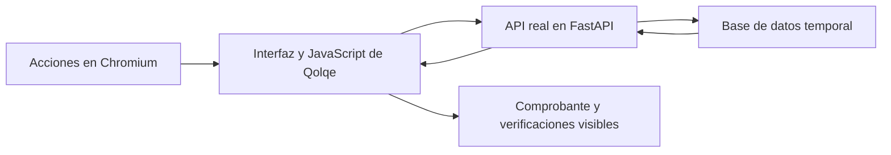

> **Estado actual:** hay 17 casos E2E (seis comunes y once de Recargas). Este
> documento conserva los cinco primeros flujos de Recargas como ejemplos
> históricos; la matriz vigente está en `features/web.feature` y los specs.
> Consulta [revisión de arquitectura](revision-arquitectura-pruebas.md).

# Pruebas E2E web de G1: qué son, por qué usamos Playwright y cómo funcionan

Este documento explica la decisión de automatización del módulo **G1 – Recargas**
de Qolqe Wallet. Está basado en las pruebas y la configuración del repositorio.
Distingue lo que ya se implementó de lo que aún queda por cubrir.

## 1. Qué significa E2E web

**E2E** significa *End-to-End*, es decir, **de extremo a extremo**. Una prueba E2E
web utiliza un navegador para realizar acciones como las de un usuario y comprobar
el resultado visible de un flujo de la aplicación.

En Qolqe, un ejemplo es:

1. Abrir la pantalla de login.
2. Escribir el celular y el PIN.
3. Iniciar sesión.
4. Abrir Recargas.
5. Introducir el número de destino y seleccionar un monto.
6. Pulsar «Recargar».
7. Comprobar el comprobante y la actualización del historial.

No basta con comprobar que el botón exista: la prueba realiza la operación y
verifica datos que debe mostrar la pantalla, como monto, bono y saldo.



Aquí los extremos son el navegador y el resultado del flujo dentro de Qolqe.
No se conecta con una operadora telefónica real: es una billetera ficticia. Los
SMS simulados se comprueban en pruebas API; los casos E2E no verifican su
recepción.

## 2. Por qué necesitamos pruebas web si ya probamos la API

Una API puede responder correctamente y, aun así, la pantalla presentar problemas.
Por ejemplo, el navegador podría enviar otro monto, no ejecutar la solicitud al
pulsar el botón o mostrar un saldo equivocado en el comprobante.

| Tipo de prueba | Qué hace | Qué permite comprobar en este proyecto |
|---|---|---|
| API con Playwright | Envía solicitudes HTTP directamente | Respuestas, códigos de error, reglas y efectos consultados por API |
| E2E web con Playwright | Opera la interfaz mediante Chromium | Integración de formularios, sesión, solicitudes y resultados visibles |
| Contrato con Schemathesis | Genera solicitudes a partir de OpenAPI | Diferencias entre los datos y respuestas que describe el contrato y lo que acepta o devuelve la API |

Estas pruebas se complementan. Usamos los casos API para explorar más combinaciones
y las pruebas web para comprobar flujos representativos desde la interfaz.
No trasladamos todas las combinaciones de la API al navegador porque mantener y
analizar tantos flujos web añadiría trabajo sin que cada repetición aporte una
verificación diferente de la interfaz.

## 3. Por qué elegimos Playwright

La elección responde a las necesidades de la segunda entrega y al estado del
repositorio. No significa que sea la única herramienta válida para cualquier proyecto.

### 3.1. Una herramienta para API y navegador

La automatización activa usa Playwright Test para las solicitudes API y los flujos
web. Ambos tipos comparten comandos npm, configuración de ejecución y reportes.
Esto reduce la cantidad de herramientas activas que el equipo debe configurar y
explicar para la entrega.

Los 71 casos de Recargas se migraron desde Karate conservando las expectativas,
las historias y las reglas. Karate permanece en el repositorio como referencia
histórica; el workflow activo ejecuta Playwright y Schemathesis.

### 3.2. Separación entre pruebas y pantallas

Playwright se usa con **Page Object Model (POM)**. Los objetos de página concentran
los selectores y las acciones, mientras que los casos expresan el flujo y sus
resultados esperados. Si cambia un selector de Recargas, se busca su definición en
el objeto de página y se evita repetir la corrección en cada prueba.

### 3.3. Evidencia de ejecución

La configuración genera HTML para revisión humana, JUnit XML para resultados
estructurados y un JSON propio de trazabilidad. Ante fallos web conserva capturas
y trazas para investigar qué ocurrió.

### 3.4. Integración con GitHub Actions

Los mismos comandos del proyecto se ejecutan en CI ante push y pull request.
El workflow instala dependencias y Chromium, inicia las pruebas y publica los 
artefactos aunque haya fallos.

### 3.5. Schemathesis conserva una función propia

La unificación de API y web no elimina las pruebas de contrato. Schemathesis sigue
como trabajo independiente para generar y comprobar solicitudes desde OpenAPI.
La decisión de usar Playwright no sustituye este requisito de la entrega.

## 4. Cómo aplicamos Page Object Model

Los archivos principales son:

| Archivo | Responsabilidad |
|---|---|
| [recargas.spec.js](../tests/e2e/recargas.spec.js) | Preparación de cada prueba, flujos y aserciones |
| [login.page.js](../tests/e2e/pages/login.page.js) | Abrir login, introducir credenciales e ingresar |
| [recargas.page.js](../tests/e2e/pages/recargas.page.js) | Selectores y acciones de Recargas y programadas |
| [playwright.config.js](../playwright.config.js) | Navegador, proyectos, servidor, concurrencia y reportes |
| [servidor_pruebas.py](../scripts/servidor_pruebas.py) | Servidor exclusivo y base temporal |
| [trazabilidad-reporter.js](../tests/support/trazabilidad-reporter.js) | Resultado por caso, HU, reglas, etiquetas de endpoint y pipeline |

Por ejemplo, el caso llama a una acción del objeto de página y después comprueba
el resultado:

```javascript
await recargas.recargar('999888777', 50);
await expect(recargas.comprobante).toBeVisible();
await expect(recargas.bono).toContainText('2.50');
```

Dentro de `recargar()`, el objeto de página rellena el celular, pulsa el monto
visible y envía el formulario. En la implementación actual se selecciona el texto
visible del monto porque los radios nativos están ocultos por el diseño de la
pantalla. Intentar interactuar directamente con el radio oculto produjo un
problema de automatización que se corrigió en el Page Object.

Los selectores usan principalmente `data-testid`; también se usan roles y texto
visible. Las aserciones sobre elementos esperan el estado solicitado dentro de su
tiempo límite, sin introducir pausas fijas con `sleep` en los casos web.

## 5. Preparación e independencia de los casos

Antes de cada E2E, `beforeEach`:

1. Restablece el reloj mediante la API de soporte.
2. Restaura los datos semilla.
3. Abre el navegador e inicia sesión por la pantalla como Ana.
4. Abre `/recargas` y espera las seis opciones de monto.

Cada caso usa un contexto de navegador nuevo proporcionado por Playwright, y la
restauración evita depender de los cambios de saldo o programadas de otro caso.

La API se utiliza para preparar los datos. Por ejemplo, el caso de saldo
insuficiente fija el saldo en `4.99` antes de intentar una recarga de S/ 5 desde
la web. Esto no sustituye el recorrido de usuario que se quiere verificar: la
recarga y el error se prueban desde la pantalla.

El servidor de Playwright se inicia en `127.0.0.1:8011`, con una base y una
plantilla de datos temporales. La configuración no reutiliza un servidor existente.
Schemathesis usa otra instancia en el puerto `8012`.

Se usa **un worker**, sin ejecución paralela completa y sin reintentos. El reloj y
el reinicio de datos afectan a la instancia entera; varios casos simultáneos
podrían invalidar sus sesiones o alterar sus datos. No se deben lanzar dos suites
Playwright a la vez sobre ese mismo puerto.

## 6. Cinco flujos de Recargas que se implementaron primero

| Caso | Acción desde la web | Comprobación actual |
|---|---|---|
| `CP-WEB-G1-01` | Recargar S/ 50 al `999888777` | Comprobante visible; celular, monto, bono S/ 2.50, saldo S/ 1,450.00, código no vacío y presencia del número en el historial |
| `CP-WEB-G1-02` | Intentar recargar S/ 10 al `899888777` | Error visible y comprobante oculto |
| `CP-WEB-G1-03` | Con saldo S/ 4.99, intentar recargar S/ 5 | Mensaje de saldo insuficiente y comprobante oculto |
| `CP-WEB-G1-04` | Crear una programada por S/ 10, día 28; pausar, reanudar y eliminar | Estados Activa/Pausada/Activa y desaparición de la fila tras confirmar la eliminación |
| `CP-WEB-G1-05` | Intentar programar para el día 29 | Error visible y ausencia de la programada con el alias usado |

Los casos incluyen etiquetas de historias y reglas en sus nombres. La suite web
no incluye actualmente etiquetas `@endpoint-...` en sus títulos; esas etiquetas se
adaptaron a los 71 casos API. Por ello el campo `endpoints` del reporte puede estar
vacío para un E2E y no significa que el navegador no haya consultado la API.

## 7. Qué cubren y qué no demuestran

Los casos web verifican flujos concretos. Su aprobación no demuestra por sí sola
que toda la interfaz o todas las reglas estén libres de defectos.

En particular, la suite web actual:

- Usa Chromium con el perfil de escritorio `Desktop Chrome`; no prueba Firefox,
  WebKit, dispositivos móviles ni navegadores instalados en equipos de usuarios.
- Comprueba el bono en el comprobante de S/ 50, y ahora verifica también la vista previa mediante CP-WEB-G1-06,
  incorporado posteriormente para HU-G1-01 CA4.
- No comprueba por web los límites de quinta/sexta recarga ni el rechazo al
  reanudar con tres programadas activas. Esas condiciones se prueban por API.
- No automatiza la edición de programadas ni su ejecución mensual desde la web.
- No mide rendimiento ni accesibilidad. Dos de los casos actuales sí hacen
  comparación visual de capturas del formulario y del comprobante.
- En los casos de celular y día inválidos comprueba la presencia del error,
  pero no exige un mensaje textual específico.
- No consulta el saldo persistido por API después de cada error web. Las
  verificaciones de ausencia de descuento o registros están en la suite API.

Estas son limitaciones del alcance actual, no funcionalidades que se hayan
implementado automáticamente por usar Playwright.

## 8. Cómo ejecutar y ver las pruebas

Desde la raíz del proyecto, se necesitan Python 3.11 o superior, Node.js 22 y las
dependencias. Si ya existe `env/`, se puede activar ese entorno en lugar de crear otro.

```bash
python -m venv .venv
source .venv/bin/activate
pip install -r requirements-dev.txt
npm ci
npx playwright install chromium
```

En Windows PowerShell, la activación es:

```powershell
.venv\Scripts\Activate.ps1
```

Con el entorno activado:

```bash
# Solo E2E web; el servidor se inicia automáticamente.
npm run test:e2e

# Ver el navegador mientras se ejecutan.
npm run test:e2e -- --headed

# Ejecutar solo el caso del comprobante.
npm run test:e2e -- --grep CP-WEB-G1-01

# Abrir el reporte HTML ya generado.
npm run report
```

No es necesario iniciar uvicorn manualmente. El puerto `8011` debe estar libre.
El modo `--headed` requiere un entorno gráfico. `npm test` ejecuta también las
pruebas API y puede terminar con errores por los defectos conocidos del producto.

Para ejecutar contrato, instala además `requirements-contract.txt` y usa
`npm run test:contract`. La [guía general](guia-playwright-recargas.md) contiene los
comandos de todas las suites.

## 9. Reportes, pipeline y análisis de un fallo

| Evidencia | Ubicación |
|---|---|
| Reporte HTML | `reportes/playwright/html/index.html` |
| JUnit XML | `reportes/playwright/junit.xml` |
| Trazabilidad JSON | `reportes/playwright/trazabilidad.json` |
| Capturas y trazas ante fallos | Subcarpetas de `reportes/playwright/resultados/` |

En GitHub Actions, abre una ejecución de **G1 Recargas**, revisa el trabajo
`playwright` y descarga el artefacto **playwright-evidencia**. La retención
configurada es de 30 días. El contrato tiene el artefacto separado
**schemathesis-evidencia**.

La configuración conserva capturas y trazas cuando falla una prueba; no crea
un video de cada ejecución ni captura automáticamente todos los casos aprobados.
Cada comando de Playwright genera el reporte de los casos de esa ejecución: un
reporte de `test:e2e` no contiene los resultados de todas las pruebas API.

Ante un fallo, revisa primero la acción o aserción que falló, el estado de la
pantalla y la traza. Distingue entre un error en el selector o preparación y un
comportamiento que incumple el requisito. No cambies la expectativa solo para
hacer que la ejecución termine en verde.

## 10. Resultados documentados y costos

En la validación local del 30/10/2026, **los cinco E2E de aquella versión
aprobaron**. El conjunto de Playwright tuvo 81 casos: 73 aprobados y 8 fallidos
por defectos conocidos de API. La suite web actual tiene 17 casos; no se debe
extrapolar ese resultado histórico a la suite ampliada. Consulta
[validacion-playwright.md](validacion-playwright.md). Este documento no representa
una nueva ejecución.

Para el uso de Playwright en este proyecto no se ha registrado una compra de
licencia. Esto no equivale a costo total cero: el equipo, internet, tiempo de
mantenimiento y consumo de CI son recursos. No se han auditado la facturación de
GitHub ni las horas del equipo, por lo que no se asigna un monto monetario real.

## 11. Explicación breve para la exposición

> Elegimos Playwright porque permite mantener las pruebas API y web en una misma
> herramienta, con reportes e integración continua comunes. E2E web significa
> ejecutar un flujo desde un navegador como lo haría un usuario y comprobar su
> resultado visible. En Recargas automatizamos flujos representativos con Chromium y
> organizamos los selectores y acciones con Page Object Model. Los datos se
> preparan en una base temporal y se restauran antes de cada caso. Estas pruebas
> complementan los 71 casos API y las pruebas de contrato de Schemathesis; no los
> reemplazan ni demuestran una cobertura total de la aplicación.

## 12. Documentos relacionados

- [Guía de Playwright y Schemathesis](guia-playwright-recargas.md).
- [Resultados de la validación documentada](validacion-playwright.md).
- [Requisitos y reglas de negocio](requisitos.md).
- [Defectos registrados](defectos.md).
- [Guion de exposición](presentacion/guion-exposicion.md).
