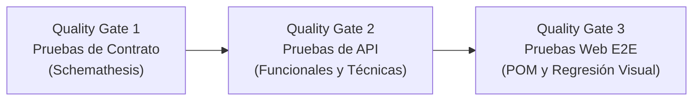

# G1 – Recargas con Playwright

La automatización activa usa Playwright Test para API y web, Page Object Model para
la interfaz y Schemathesis para contrato. No modifica la aplicación `qolqe/`.
Los archivos Karate se conservan como referencia histórica de la primera entrega;
el pipeline ejecuta las suites nuevas.

## Instalación

Se requiere Python 3.11 o superior y Node.js 22.

```bash
python -m venv .venv
source .venv/bin/activate
# PowerShell: .venv\Scripts\Activate.ps1
pip install -r requirements-dev.txt -r requirements-contract.txt
npm ci
npx playwright install chromium
```

## Ejecución

Con el entorno Python activado, desde la raíz:

```bash
npm test
npm run test:api
npm run gate:api
npm run test:e2e
npm run test:api -- --grep @R-G1-02
npm run test:api -- --grep CP-G1-01
npm run test:contract
npm run report
```

Playwright levanta automáticamente una API en `127.0.0.1:8011`; Schemathesis usa
`127.0.0.1:8012`. Ambos crean bases temporales y detienen su servidor al terminar.
Los puertos deben estar libres. No se reutilizan servidores existentes. Para usar
otro intérprete con Playwright, define `QOLQE_PYTHON` con su ruta.
Se ejecuta un solo worker y sin reintentos: el reloj y los reinicios son globales.
No ejecutes dos comandos Playwright simultáneamente.

## Casos y trazabilidad

`tests/api/recargas.spec.js` migra los **71 casos** de `api.feature` en su mismo
orden, con identificadores `CP-G1-01` a `CP-G1-71`. Conserva las etiquetas HU,
criterios de aceptación y `R-G1-01` a `R-G1-05`. También se migran los cinco casos de salud y autenticación a
`tests/api/autenticacion.spec.js`. Los detalles originales de cada caso
están en [casos-api-recargas.md](casos-api-recargas.md); los enlaces a Karate sirven
como fuente histórica. [trazabilidad-recargas.json](trazabilidad-recargas.json)
relaciona cada CP con su nombre y etiquetas. Las verificaciones de acceso pertenecen
transversalmente a G1.

| Regla | Cobertura |
|---|---|
| R-G1-01 | Montos permitidos, valores inválidos y celular |
| R-G1-02 | Bono, umbral y tope |
| R-G1-03 | Cinco recargas por número y día, manuales y programadas |
| R-G1-04 | Máximo de tres programadas activas, pausa y reanudación |
| R-G1-05 | Día 1–28 y duplicados |

`tests/e2e/recargas.spec.js` añade `CP-WEB-G1-01` a `06`: recarga y comprobante,
celular inválido, saldo insuficiente, ciclo de programada, día inválido y regresión visual.
Los selectores y acciones están en `tests/e2e/pages/`. Las pruebas ingresan desde
la pantalla de login y usan la API real, sin simular respuestas.

## Reportes y pipeline CI/CD (Quality Gates)

`.github/workflows/pruebas.yml` ejecuta una arquitectura en cascada gobernada por **tres Quality Gates**:



1. **Quality Gate 1 - Pruebas de Contrato (Schemathesis):**  
   Se ejecuta en primer lugar. Valida exhaustivamente que la API cumpla el contrato OpenAPI (`openapi.json`) en las 9 operaciones de recargas. Si el contrato falla, no se gasta tiempo ni recursos en pruebas posteriores.
2. **Quality Gate 2 - Pruebas de API Funcionales y Técnicas (Playwright API):**  
   Se ejecuta tras superar el Gate 1 (`needs: [contrato]`). Ejecuta los 76 casos (técnicos: `@smoke`, `@auth`, `@seguridad-recargas`; funcionales: `HU-G1-01` a `HU-G1-07` y `R-G1-01` a `R-G1-05`). El evaluador `scripts/quality_gate_api.js` valida que los 68 casos esperados aprueben y que los 8 casos fallidos correspondan exactamente a los defectos documentados (DEF-02 a DEF-05), impidiendo cualquier regresión.
3. **Quality Gate 3 - Pruebas Web E2E (Playwright Web):**  
   Se ejecuta únicamente tras superar el Gate 2 (`needs: [pruebas-api]`). Instala Chromium y ejecuta los flujos de usuario E2E mediante POM y regresión visual. Requiere 100% de éxito.

| Evidencia | Ruta |
|---|---|
| HTML Playwright | `reportes/playwright/html/index.html` |
| JUnit Playwright | `reportes/playwright/junit.xml` |
| HU → CP → resultado y enlace al pipeline | `reportes/playwright/trazabilidad.json` |
| Capturas y trazas de fallos web | `reportes/playwright/resultados/` |
| JUnit Schemathesis | `reportes/contrato/junit.xml` |

GitHub Actions conserva las evidencias de cada etapa como artefactos independientes (`evidencia-contrato`, `evidencia-api`, `evidencia-web`).

Referencias oficiales: [API testing](https://playwright.dev/docs/api-testing),
[servidor de pruebas](https://playwright.dev/docs/test-webserver),
[reportes](https://playwright.dev/docs/test-reporters) y
[CLI de Schemathesis](https://schemathesis.readthedocs.io/en/stable/reference/cli/).
