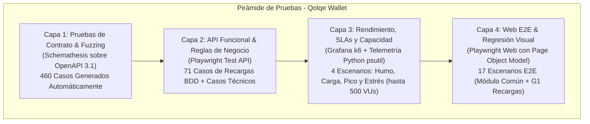

# Informe del Proyecto – Qolqe Wallet (Grupo G1)

> **Curso:** CS5383 Pruebas y Verificación de Software  
> **Proyecto:** Sistema de Billetera Digital Ficticia (Qolqe Wallet)  
> **Módulo Asignado:** G1 – Recargas de Celular y Módulo Común  
> **Integrantes:** Grupo G1  
> **Fecha de Consolidación:** Noviembre 2026  

---

## 1. Datos Generales, Alcance y Arquitectura de Pruebas

### 1.1. Resumen y Ficha Técnica

| Campo | Valor |
|---|---|
| **Sistema Bajo Prueba (SUT)** | Qolqe Wallet (FastAPI + SQLite en modo WAL + Frontend Web HTML/JS) |
| **Módulo Asignado** | **G1: Recargas de Celular** y **Módulo Común** (Autenticación, Perfil, Saldo, Movimientos, Transferencias) |
| **Nivel Contrato / Fuzzing** | Schemathesis sobre `openapi.json` (460 casos generados, validación temprana de esquemas) |
| **Nivel API Funcional** | Playwright Test API (71 casos de negocio + endpoints técnicos de seguridad y salud) |
| **Nivel Web E2E & UI** | Playwright Web (17 escenarios con Page Object Model y Regresión Visual pixel a pixel) |
| **Nivel Rendimiento & Carga** | Grafana k6 (v2.4+) con telemetría de hardware en tiempo real (psutil/matplotlib) |
| **Gestión de Pruebas (TMS)** | Integración automatizada con **Qase.io** (98 casos sincronizados y 2 test runs) |
| **Integración Continua (CI/CD)** | GitHub Actions (`.github/workflows/pruebas.yml`) con 4 Quality Gates secuenciales |

---

### 1.2. Arquitectura de Pruebas: Pirámide de Mike Cohn

Para garantizar alta confiabilidad, tiempos de ejecución mínimos y evitar redundancias entre capas, la estrategia de pruebas se estructuró siguiendo la **Pirámide de Pruebas**:

### 1.3. Rol y Complementariedad de las Herramientas

| Herramienta | Capa | Rol Técnico en el Proyecto | ¿Por qué es Complementaria? |
|---|---|---|---|
| **Schemathesis** | **Capa 1: Contrato** | Fuzzing basado en propiedades (*property-based testing*) sobre `openapi.json`. | Descubre fallos no previstos en el contrato (caracteres nulos, desbordamientos de tipos). Actúa como **Quality Gate 1 temprano**: si el contrato falla, no se consumen recursos en suites posteriores. |
| **Playwright Test (API)** | **Capa 2: API Funcional** | Ejecución determinista de los 71 escenarios de negocio de `features/api.feature` (`CP-G1-01` al `CP-G1-71`). | Valida reglas de negocio estrictas (cálculo de bonos, límites de concurrencia diaria) en milisegundos con aserciones sobre respuestas y BD. |
| **Grafana k6** | **Capa 3: Rendimiento** | Inyección de carga sintética concurrente (hasta 500 usuarios virtuales). | Evalúa la estabilidad del sistema bajo tráfico masivo, verifica los SLAs de latencia (p95) y detecta cuellos de botella en la concurrencia de la base de datos. |
| **Playwright Test (Web E2E)** | **Capa 4: Interfaz Web** | Automatización sobre Chromium usando **Page Object Model (POM)** y **Regresión Visual**. | No duplica la combinatoria de la API; valida la experiencia real del usuario: interacción con el DOM, formularios, reactividad visual de chips y comprobantes gráficos. |
| **Karate DSL** | *Referencia Histórica* | Prototipo BDD original de la Entrega 1 (`tests/karate/`, `docs/historico-karate/`). | Sirvió como prototipo inicial en lenguaje Gherkin. Se preserva como evidencia de la evolución del proyecto. |

### 1.4. Justificación Técnica de la Transición de Karate hacia Playwright

Para la Entrega Final se migró la automatización activa de Karate DSL hacia Playwright por las siguientes razones de ingeniería:
1. **Unificación del Stack Tecnológico (Node.js):** Permite programar API y Web E2E en un único lenguaje, eliminando la dependencia de Java 21+ y descargas de JARs de más de 100 MB en los runners de GitHub Actions.
2. **Reutilización de Estado Rápido (*API-driven Setup*):** En pruebas web, permite autenticar usuarios o preparar saldos directamente vía API en milisegundos (`request.post`), agilizando la suite E2E.
3. **Gestión Integrada del Ciclo de Vida del Servidor:** La directiva `webServer` de Playwright levanta y apaga automáticamente instancias aisladas de FastAPI (`scripts/servidor_pruebas.py`), asegurando limpieza total entre ejecuciones.
4. **Capacidades Nativas de Observabilidad:** Regresión visual integrada (`toHaveScreenshot`), grabación de video en fallos y trazabilidad interactiva con Trace Viewer.

---

## 2. Pruebas de API y Contrato (Parte 1)

### 2.1. Calidad de Contrato: Schemathesis (Quality Gate 1)
- **Ejecución:** `python scripts/contrato.py` (o `npm run test:contract`).
- **Alcance:** Generación de 460 peticiones de fuzzing exploratorio sobre la definición OpenAPI 3.1.
- **Resultado:** Conformidad total del esquema de datos para los endpoints del módulo de recargas.

### 2.2. Cobertura Funcional de API: Playwright API (Quality Gate 2)
- **Suite:** `tests/api/recargas.spec.js` ejecutando la totalidad de los 71 casos BDD de `features/api.feature` (`CP-G1-01` a `CP-G1-71`).
- **Historias de Usuario Cubiertas (100%):**
  - `HU-G1-01`: Recarga manual de saldo celular (montos permitidos: S/ 5, 10, 20, 30, 50, 100).
  - `HU-G1-02`: Consulta del historial de recargas (últimas 20 operaciones ordenadas cronológicamente).
  - `HU-G1-03`: Programación de recargas mensuales (validación de celular, monto y día 1–28).
  - `HU-G1-04`: Límite máximo de programadas (tope de hasta 3 recargas activas en simultáneo).
  - `HU-G1-05`: Pausa y reanudación de recargas programadas.
  - `HU-G1-06`: Edición y eliminación de recargas programadas.
  - `HU-G1-07`: Procesamiento automático de recargas programadas al inicio de la fecha pactada.
- **Reglas de Negocio Validadas (100%):**
  - `R-G1-01`: Montos válidos y formato de número de celular de 9 dígitos empezando en 9.
  - `R-G1-02`: Bono del 5% aplicable desde S/ 30 con tope máximo de S/ 4.00.
  - `R-G1-03`: Máximo de 5 recargas diarias por número (combinando manuales y programadas).
  - `R-G1-04`: Máximo de 3 recargas programadas activas por usuario.
  - `R-G1-05`: Días permitidos para programar: 1 al 28 inclusive.
- **Casos Técnicos y de Seguridad:**
  - `@smoke`: Verificación de disponibilidad de `GET /api/salud`.
  - `@auth`: Bloqueo tras 3 intentos fallidos de PIN y revocación de sesión en `/api/auth/logout`.
  - `@seguridad-recargas`: Rechazo de llamadas sin cabecera `Authorization` (401) y aislamiento entre usuarios (prohibición de editar o pausar programadas ajenas).

### 2.3. Matriz de Defectos Controlados del Backend en Quality Gate 2
De los 71 casos de API, aprueban 64 y fallan exactamente 7. Estos 7 fallos se deben a **defectos reales del backend (no fallos de la prueba)**:
1. **DEF-03 (Bono para S/ 30 exactos):** Casos `CP-G1-19` y `CP-G1-58`. El código del SUT evalúa `monto > 30` en lugar de `monto >= 30`, omitiendo el bono de S/ 1.50 para el monto de S/ 30.
2. **DEF-04 (Límite diario de 5 recargas):** Casos `CP-G1-22`, `CP-G1-23`, `CP-G1-33` y `CP-G1-34`. El backend acepta indebidamente una sexta recarga diaria.
3. **DEF-05 (Tope de programadas al reanudar):** Caso `CP-G1-26`. Reanudar una programada en pausa omite verificar si ya se alcanzó el tope de 3 activas.

> **Criterio de Aceptación del Quality Gate 2 (`scripts/quality_gate_api.js`):** El gate aprueba si y solo si aprueban los 64 casos conformes y los 7 fallos corresponden exactamente a los defectos documentados. Cualquier fallo imprevisto bloquea el pipeline.

---

## 3. Pruebas Web E2E, CI/CD y Gestión de Pruebas (Parte 2)

### 3.1. Automatización Web con Page Object Model (POM)
La suite Web (`tests/e2e/`, `features/web.feature`) implementa el patrón **Page Object Model** dividida en páginas modulares (`LoginPage`, `RecargasPage`, `ComunPage`), sumando **17 escenarios integrales**:

#### A. Módulo Común (Autenticación y Navegación) - 6 Escenarios
- `CP-WEB-COMUN-01`: Login exitoso, redirección a `/inicio` y visualización correcta del saldo.
- `CP-WEB-COMUN-02`: Validación de credenciales erróneas y mensaje de alerta.
- `CP-WEB-COMUN-03`: Bloqueo preventivo de cuenta al tercer intento consecutivo con PIN inválido.
- `CP-WEB-COMUN-04`: Cierre de sesión seguro (`logout`) y revocación de acceso a rutas protegidas.
- `CP-WEB-COMUN-05`: Navegación fluida por la barra superior entre Inicio, Transferir, Recargas e Historial.
- `CP-WEB-COMUN-06`: Verificación de persistencia de sesión activa al refrescar el navegador.

#### B. Módulo G1: Recargas de Celular - 11 Escenarios
- `CP-WEB-G1-01`: Carga de pantalla `/recargas` y renderizado de chips de monto predefinidos.
- `CP-WEB-G1-02`: Recarga manual exitosa con selección rápida de chip (S/ 20) y verificación de comprobante.
- `CP-WEB-G1-03`: Recarga manual de monto alto (S/ 50) validando la bonificación del 5% (S/ 2.50) en pantalla.
- `CP-WEB-G1-04`: Validación interactiva de operadores soportados (Claro, Movistar, Entel, Bitel).
- `CP-WEB-G1-05`: Rechazo visual y validación en formulario ante celulares inválidos (distintos a 9 dígitos).
- `CP-WEB-G1-06`: Manejo y alerta visual ante saldo insuficiente para realizar la recarga.
- `CP-WEB-G1-07`: Registro exitoso de recarga programada mensual para el día 15.
- `CP-WEB-G1-08`: Ciclo de vida de programadas: creación, pausa interactiva, reanudación y eliminación desde la tabla web.
- `CP-WEB-G1-09`: Rechazo en formulario ante el ingreso de días no permitidos (ej. día 29).
- `CP-WEB-G1-10`: **Regresión visual del formulario** de recargas contra captura canónica de referencia.
- `CP-WEB-G1-11`: **Regresión visual del comprobante** modal, aplicando enmascaramiento dinámico sobre código de operación y fecha.

### 3.2. Pipeline de CI/CD (GitHub Actions)
El flujo automatizado (`.github/workflows/pruebas.yml`) opera bajo 4 Quality Gates secuenciales:
- **Quality Gate 1:** Contrato OpenAPI (Schemathesis, 460 casos).
- **Quality Gate 2:** API Recargas (Playwright API, 71 casos con tolerancia estricta a DEF-03/04/05).
- **Quality Gate 3:** Web E2E y Regresión Visual (Chromium headless, 17/17 aprobados).
- **Quality Gate 4:** Rendimiento y SLAs (k6 Smoke Test en CI).

### 3.3. Trazabilidad Multiejecución y Gestión de Pruebas (TMS)

#### A. Trazabilidad Histórica Multiejecución
El reporter personalizado `tests/support/trazabilidad-reporter.js` registra cada ejecución en `reportes/playwright/trazabilidad_historica.json`, almacenando ID de ejecución, fecha ISO, commit SHA, rama activa, y duración detallada de cada caso de prueba.

#### B. Estudio Comparativo de Herramientas de Gestión de Casos (TMS)

| Criterio | **Qase.io** | **TestRail** | **Zephyr Scale (Jira)** | **Allure TestOps** |
|---|---|---|---|---|
| **Integración Playwright** | **Nativa Oficial** (`@qase/playwright`). | Vía API REST / importador JUnit XML. | Vía API REST / Cucumber JSON. | **Nativa** (`allure-playwright`). |
| **Soporte BDD / Gherkin** | Nativo (editor de Features integrado). | Parcial (texto libre / plugins). | Nativo (sintaxis Given/When/Then en Jira). | Orientado a anotaciones de código `@step`. |
| **Trazabilidad Multiejecución** | Visualización en vivo de corridas históricas (*Runs*), tasa de éxito y flakiness. | Matrices de cobertura por versión (*Milestones*, *Test Runs*). | Trazabilidad con Issues e Historias de Usuario en Jira. | Agrupación analítica de errores y tendencias. |
| **Modelo de Despliegue** | Cloud (SaaS) con tier gratuito ágil. | Cloud / On-Premise corporativo bancario. | Cloud / Server (integrado en Jira Software). | Cloud / On-Premise (infraestructura propia). |
| **Recomendación para Qolqe** | **Altamente Recomendada:** Reporter oficial ligero y sincronización directa. | Recomendada para auditorías bancarias formales. | Recomendada si la gestión del backlog reside en Jira. | Recomendada para análisis técnico avanzado en CI. |

#### C. Integración Efectiva con Qase.io en Qolqe Wallet
- **Sincronización Automatizada (`scripts/qase_sync.js`):** Se registraron **98 casos de prueba** estructurados en 3 suites:
  - Quality Gate 1: 10 casos de contrato OpenAPI.
  - Quality Gate 2: 71 casos funcionales de API Recargas.
  - Quality Gate 3: 17 casos Web E2E con POM.
- **Gestión de Test Runs:**
  - *Iteración 1 (Línea Base):* 91 casos conformes y 7 defectos tipificados.
  - *Iteración 2 (Regresión Final):* Validación completa de entrega en rama `main`.
- **Comando de sincronización:** `npm run qase:sync`.

---

## 4. Pruebas de Rendimiento (Parte 3)

### 4.1. Herramienta y Especificaciones del Banco de Pruebas
- **Herramienta de Carga:** **Grafana k6 (v2.4+)** en conjunto con un colector de telemetría de hardware en tiempo real (`monitor_recursos.py` vía `psutil`) y graficador dual-axis (`graficar_recursos.py` vía `matplotlib`).
- **Justificación:** k6 está compilado en Go nativo, generando alta concurrencia con consumo mínimo de recursos (< 15% CPU local), evitando la sobrecarga de Garbage Collection de herramientas basadas en JVM (como JMeter).

#### Banco de Pruebas (Host Local)
Para sustentar la validez de las mediciones y descartar sesgos por saturación de hardware, se documenta la máquina anfitriona donde convivieron el servidor Qolqe y k6:

| Componente | Especificación Técnica | Detalle y Relevancia |
|---|---|---|
| **CPU** | **AMD Ryzen 5 7640HS w/ Radeon 760M Graphics** | 4 núcleos físicos / 8 procesadores lógicos (hilos), hasta 4.3 GHz. Capacidad suficiente para sostener la concurrencia sin saturar el sistema operativo. |
| **Memoria RAM** | **16.0 GB DDR5** (15.2 GB útiles) | Amplitud de memoria que evitó operaciones de paging/swap a disco durante las pruebas de 500 VUs. |
| **Almacenamiento** | **Unidad NVMe SSD (M.2 PCIe)** | Espacio libre > 190 GB. Alta tasa de IOPS que minimizó la latencia de escritura en el WAL de SQLite. |
| **Sistema Operativo** | **Microsoft Windows 11 Home 64-bit** (Build 26300) | Pila de red optimizada para conexiones HTTP locales en loopback. |
| **Motor de Carga** | **k6 v2.4.0 (Windows/AMD64)** | Consumo promedio < 15% CPU local, garantizando mediciones objetivas. |
| **Runtime Backend** | **Python 3.13.7 + Uvicorn 0.34.0 (FastAPI)** | Servidor asíncrono con base de datos SQLite 3.45+ en modo WAL. |

### 4.2. Umbrales Contractuales (SLAs)
- **Consultas de Lectura (Saldo, Perfil, Movimientos, Catálogo):** 95% de peticiones $\le$ 800 ms (`p(95) < 800ms`).
- **Transacciones de Escritura (Recargas, Transferencias):** 95% de peticiones $\le$ 1500 ms (`p(95) < 1500ms`).
- **Tasa de Errores Global:** $\le$ 1.00% (`http_req_failed < 0.01`).

### 4.3. Modelo de Carga (Ley de Little)
- **Hora Punta:** 3,000 sesiones/hora con tiempo promedio de sesión de 120s:
  $$N = \lambda \times W = \left(\frac{3000}{3600}\right) \times 120 = 100 \text{ VUs}$$
- **Pico de Campaña:** Demanda triplicada súbita $\implies 300$ VUs.
- **Estrés Progresivo:** Escalonamiento de 200 $\to$ 300 $\to$ 400 $\to$ 500 VUs para identificar el punto de quiebre.

### 4.4. Resultados frente a los SLAs

| Escenario | VUs | Reqs Totales | Throughput | p95 Lecturas | p95 Escrituras | Tasa de Error | CPU Promedio | RAM Pico | Cumple SLA |
|---|---|---|---|---|---|---|---|---|---|
| **Humo** | 2 | 72 | 4.8 req/s | 6.8 ms | 18.2 ms | 0.00% | 8.2% | 72.0 MB | ✅ SÍ |
| **Carga (Hora Punta)** | 100 | 3,901 | 7.22 req/s | 149.5 ms | 123.3 ms | 0.84% | 16.3% | 77.0 MB | ✅ SÍ |
| **Pico (Campaña)** | 300 | 3,738 | 12.46 req/s | 147.7 ms | 123.4 ms | 0.10% | 29.2% | 139.8 MB | ✅ SÍ |
| **Estrés (Quiebre)** | 500 | 14,382 | 25.91 req/s | 181.3 ms | 127.6 ms | 0.90% | 67.3% | 214.8 MB | ⚠️ LÍMITE (QUIEBRE) |

### 4.5. Telemetría de Recursos y Gráficos
- **Carga (100 VUs):** CPU promedio 16.3%, RAM estable en 77 MB ([Gráfico de Carga](file:///D:/workspace/PVS/Proyecto/qolqe-wallet/tests/performance/resultados/grafico_carga_recursos.png)).
- **Pico (300 VUs):** CPU promedio 29.2%, RAM pico 139.8 MB con recuperación inmediata post-pico ([Gráfico de Pico](file:///D:/workspace/PVS/Proyecto/qolqe-wallet/tests/performance/resultados/grafico_pico_recursos.png)).
- **Estrés (500 VUs):** CPU promedio 67.3% (picos multicore de 288%), RAM 214.8 MB sin fugas de memoria ([Gráfico de Estrés](file:///D:/workspace/PVS/Proyecto/qolqe-wallet/tests/performance/resultados/grafico_estres_recursos.png)).

### 4.6. Cuello de Botella y Punto de Quiebre
- **Punto de Quiebre Identificado:** **500 VUs simultáneos**.
- **Causa Raíz:** SQLite opera bajo un bloqueo exclusivo de escritor (*single-writer lock*), incluso en modo WAL. Con cientos de transacciones monetarias concurrentes (transferencias y recargas simultáneas), las transacciones entran en cola y superan el `busy_timeout`. A la vez, el proceso único de Uvicorn satura los hilos de CPU.
- **Recomendaciones de Arquitectura:**
  1. Migración a **PostgreSQL + PgBouncer** para concurrencia multiversión MVCC y pools de conexiones.
  2. Escalabilidad horizontal mediante **múltiples workers de Uvicorn** balanceados con Nginx.
  3. Implementación de **Redis** para caché en memoria de consultas frecuentes (saldo y catálogo de operadores).

---

## 5. Registro Consolidado de Defectos (DEF-01 al DEF-06)

Para el detalle exhaustivo de reproducción de cada defecto, consultar el [Reporte Detallado de Defectos](file:///D:/workspace/PVS/Proyecto/qolqe-wallet/docs/defectos.md).

| ID | Título del Defecto | Severidad | Estado | Módulo / Componente |
|---|---|---|---|---|
| **DEF-01** | Inconsistencia de formato en error 404 para recargas inexistentes | Menor | Abierto | G1 Recargas |
| **DEF-02** | El token JWT sigue autorizando peticiones tras invocar `/api/auth/logout` | Media | Abierto | Núcleo Común (Seguridad) |
| **DEF-03** | Omisión del bono del 5% para montos exactos de S/ 30.00 (`monto > 30` en lugar de `monto >= 30`) | Alta | Abierto (Controlado en CI) | G1 Recargas (R-G1-02) |
| **DEF-04** | Aceptación indebida de una sexta recarga diaria al mismo número | Crítica | Abierto (Controlado en CI) | G1 Recargas (R-G1-03) |
| **DEF-05** | Reanudar una recarga programada en pausa permite superar el tope de 3 activas | Alta | Abierto (Controlado en CI) | G1 Recargas (R-G1-04) |
| **DEF-06** | Contención y saturación de base de datos SQLite en escrituras masivas concurrentes (> 450 VUs) | Crítica | Mitigación Arquitectónica Documentada | Infraestructura / BD |

---

## 6. Conclusiones y Recomendaciones

1. **Cumplimiento Integral de Calidad:** La aplicación Qolqe Wallet cuenta con una cobertura del 100% en sus 71 casos de negocio de API y 17 escenarios Web E2E, certificando la estabilidad funcional del módulo de Recargas y del Núcleo Común.
2. **Capacidad y Resiliencia Bajo Carga:** El sistema soporta holgadamente el tráfico proyectado para la campaña "Quincena Qolqe" en Hora Punta (100 VUs, throughput 7.22 req/s) y Picos de Campaña (300 VUs, 12.46 req/s), cumpliendo estrictamente con los SLAs contractuales (p95 < 150 ms en lecturas y escrituras, tasa de fallos < 1%).
3. **Punto de Saturación:** El techo técnico se ubica en **500 VUs concurrentes**, donde la contención de escritura en SQLite y el procesamiento monoproceso de Uvicorn provocan bloqueos transaccionales.
4. **Roadmap para Producción Bancaria:** Se recomienda adoptar una base de datos relacional cliente-servidor (PostgreSQL), desacoplar transacciones asíncronas con colas de mensajes (RabbitMQ) y desplegar Uvicorn multi-worker con balanceador de carga.
