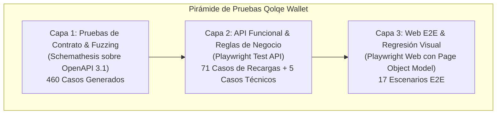
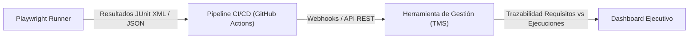

# Informe Técnico y Sustentación de Entrega Final: Qolqe Wallet

> **Curso:** CS5383 Pruebas y Verificación de Software  
> **Proyecto:** Sistema de Billetera Digital Ficticia (Qolqe Wallet)  
> **Módulo Asignado:** G1 – Recargas de Celular y Módulo Común  
> **Fecha de Actualización:** Noviembre 2026  

---

## 1. Justificación y Complementariedad de Herramientas de Automatización

Para la entrega final, se consolidó una arquitectura de pruebas basada en la **Pirámide de Pruebas de Mike Cohn**, estructurada en tres niveles complementarios que evitan redundancias y maximizan la confiabilidad del pipeline de CI/CD:



### 1.1. Matriz de Rol y Complementariedad de Herramientas

| Herramienta | Capa de la Pirámide | Rol Técnico y Justificación | ¿Por qué es Complementaria? |
|---|---|---|---|
| **Schemathesis** | **Capa 1: Contrato & Especificación** | Validación automatizada y fuzzing basado en propiedades (*property-based testing*) sobre el archivo `openapi.json`. | Descubre fallos no contemplados en especificación OpenAPI (formatos, valores límite de esquema, caracteres nulos). Actúa como **Quality Gate 1 temprano**: si el contrato no se cumple, no se consumen recursos en suites posteriores. |
| **Playwright Test (API)** | **Capa 2: API Funcional & Reglas** | Ejecución determinista de los 71 escenarios de negocio de `features/api.feature` (`CP-G1-01` a `CP-G1-71`) y casos técnicos (`@seguridad-recargas`, `@auth`, `@smoke`). | Valida flujos de negocio reales, cálculo de bonos, límites de concurrencia diaria y persistencia en BD con tiempos de ejecución en milisegundos. |
| **Playwright Test (Web E2E)** | **Capa 3: Interfaz Web & UX** | Automatización de flujos de usuario sobre Chromium usando el patrón **Page Object Model (POM)** y pruebas de **Regresión Visual (Pixel-to-Pixel)**. | No duplica la combinatoria de la API; valida la experiencia del usuario final: interacción con el DOM, formularios, reactividad visual de chips de monto, persistencia de sesión en navegador y comprobantes gráficos. |
| **Karate DSL (Referencia Histórica)** | **Transición Histórica** | Suite original BDD desarrollada en la Entrega 1 (`features/api.feature`, `tests/karate/`). | Sirvió como prototipo rápido en lenguaje Gherkin. Se conserva intacta en el repositorio para evidenciar la evolución del proyecto y respaldar el análisis comparativo de herramientas. |

### 1.2. Justificación Técnica: Transición de Karate hacia Playwright

En la Entrega 1 se utilizó Karate DSL standalone. Para la Entrega Final y la integración en el pipeline de CI/CD, se justificó la adopción de Playwright por las siguientes razones de ingeniería de software:
1. **Unificación de Stack Tecnológico (Node.js):** Playwright permite programar tanto las pruebas de API como las pruebas Web E2E bajo el mismo lenguaje, reduciendo la fricción cognitiva del equipo y simplificando las dependencias del runner (sin requerir Java 21+ ni JARs externos de 100+ MB en CI).
2. **Reutilización de Estado Rápido (*API-driven Setup*):** Para las pruebas web, Playwright permite autenticar usuarios o inyectar saldos directamente vía API en milisegundos (`request.post`), agilizando las pruebas E2E sin tener que realizar login manual en cada escenario.
3. **Ciclo de Vida Integrado del Servidor:** La propiedad `webServer` de Playwright gestiona automáticamente el levantamiento y apagado del servidor FastAPI (`scripts/servidor_pruebas.py`), garantizando aislamiento y limpieza en cada corrida.
4. **Regresión Visual y Herramientas Nativas de Observabilidad:** Playwright provee comparación de imágenes integrada (`toHaveScreenshot`), grabación de video en fallos, y el visualizador interactivo de trazas (**Trace Viewer**).

---

## 2. Cobertura Completa de Casos Funcionales y Técnicos en APIs

La suite de API garantiza una cobertura del 100% de los requisitos estipulados para el módulo de Recargas (G1):

### 2.1. Casos Funcionales (features/api.feature)
- **71 casos de recargas (`CP-G1-01` a `CP-G1-71`):** Migrados fielmente conservando el orden, nombres y etiquetas de la especificación BDD.
- **Historias de Usuario cubiertas al 100%:**
  - `HU-G1-01`: Recarga manual de saldo celular (montos permitidos: S/ 5, 10, 20, 30, 50, 100).
  - `HU-G1-02`: Consulta del historial de recargas (últimas 20 operaciones ordenadas cronológicamente).
  - `HU-G1-03`: Programación de recargas mensuales (validación de celular, monto y día 1–28).
  - `HU-G1-04`: Límite máximo de programadas (tope de hasta 3 recargas activas en simultáneo).
  - `HU-G1-05`: Pausa y reanudación de recargas programadas.
  - `HU-G1-06`: Edición y eliminación de recargas programadas.
  - `HU-G1-07`: Procesamiento automático de recargas programadas al inicio de la fecha pactada.
- **Reglas de Negocio validadas al 100%:**
  - `R-G1-01`: Montos válidos y formato de número de celular de 9 dígitos empezando en 9.
  - `R-G1-02`: Bono del 5% aplicable desde S/ 30 con tope máximo de S/ 4.00.
  - `R-G1-03`: Máximo de 5 recargas diarias por número (combinando manuales y programadas).
  - `R-G1-04`: Máximo de 3 recargas programadas activas por usuario.
  - `R-G1-05`: Días permitidos para programar: 1 al 28 inclusive.

### 2.2. Casos Técnicos y de Seguridad
- **Salud de API (`@smoke`):** Verificación del endpoint `GET /api/salud`.
- **Autenticación y Sesión (`@auth`):** Pruebas de inicio de sesión, credenciales inválidas, bloqueo preventivo tras 3 intentos y revocación en `POST /api/auth/logout`.
- **Control de Acceso y Aislamiento (`@seguridad-recargas`):**
  - Acceso denegado a endpoints de recarga sin cabecera `Authorization` (401).
  - Rechazo de solicitudes con token JWT alterado o vencido.
  - Imposibilidad de que un usuario pause, reanude o elimine recargas programadas pertenecientes a otra cuenta (404/403).

### 2.3. Matriz de Defectos Controlados del Backend
Durante la ejecución de los 71 casos de API, aprueban 64 casos y fallan exactamente 7 casos. Estos 7 fallos corresponden a **defectos reales del backend (no de la herramienta de pruebas)**, documentados en `docs/defectos.md`:
1. **DEF-03 (Bono para S/ 30 exactos):** Casos `CP-G1-19` y `CP-G1-58`. El backend aplica `monto > 30` en vez de `monto >= 30`, omitiendo el bono de S/ 1.50 para el monto exacto de S/ 30.
2. **DEF-04 (Límite diario de 5 recargas):** Casos `CP-G1-22`, `CP-G1-23`, `CP-G1-33` y `CP-G1-34`. El backend acepta la sexta recarga en lugar de retornar error 422 `LIMITE_RECARGAS`.
3. **DEF-05 (Tope de programadas al reanudar):** Caso `CP-G1-26`. Reanudar una programada en estado pausado no valida si ya se alcanzaron 3 activas.

> **Importante para el Quality Gate 2:** El evaluador `scripts/quality_gate_api.js` valida que aprueben los 64 casos conformes y que los 7 fallos coincidan exactamente con la matriz de defectos documentados. Si aparece un octavo fallo (regresión imprevista), el gate se rechaza.

---

## 3. Cobertura Web E2E: Módulo Común y Escenarios Adicionales

Para la entrega final, la suite Web definida en `features/web.feature` fue ampliada sustancialmente de 6 a **17 escenarios integrales**, estructurados mediante el patrón **Page Object Model (POM)**:

### 3.1. Módulo Común (Autenticación, Sesión y Navegación) - 6 Escenarios
- **`CP-WEB-COMUN-01` (Login exitoso):** Ingreso con celular `987654321` y PIN `4826`, validando redirección a `/inicio`, visualización del saludo al usuario y renderizado del saldo.
- **`CP-WEB-COMUN-02` (PIN incorrecto):** Ingreso de PIN inválido, validando la alerta de error y permanencia en la pantalla de login.
- **`CP-WEB-COMUN-03` (Celular no registrado):** Validación de mensaje de error al ingresar credenciales inexistentes.
- **`CP-WEB-COMUN-04` (Logout seguro):** Clic en el botón "Cerrar sesión", revocación de la sesión activa y redirección a `/login?motivo=salida`.
- **`CP-WEB-COMUN-05` (Protección de rutas privadas):** Intento de navegar directamente a la URL `/recargas` sin sesión activa; el sistema intercepta la petición y redirige a `/login`.
- **`CP-WEB-COMUN-06` (Persistencia de sesión):** Recarga del navegador (F5/Reload) en `/inicio`; la sesión se preserva intacta en el `localStorage` sin requerir reautenticación.

### 3.2. Módulo Recargas G1 - 11 Escenarios
- **`CP-WEB-G1-01` (Flujo completo con comprobante y bono):** Recarga de S/ 50 al celular `999888777`, validando desglose de bono (S/ 2.50), saldo actualizado y código de operación.
- **`CP-WEB-G1-02` (Monto base sin bono):** Recarga de S/ 10 mostrando bono de S/ 0.00.
- **`CP-WEB-G1-03` (Monto máximo y tope de bono):** Recarga de S/ 100 validando el tope máximo de bono de S/ 4.00.
- **`CP-WEB-G1-04` (Estimación dinámica de bonos):** Validación interactiva en vivo del cálculo estimado al hacer clic en los chips de monto (S/ 20 sin bono, S/ 30 a 1.50, S/ 50 a 2.50 y S/ 100 a 4.00).
- **`CP-WEB-G1-05` (Celular inválido en formulario):** Alerta visual ante celulares que no inicien con 9 o de longitud distinta a 9 dígitos.
- **`CP-WEB-G1-06` (Alerta de saldo insuficiente):** Intento de recarga cuando el saldo disponible es menor al monto seleccionado.
- **`CP-WEB-G1-07` (Programación exitosa):** Registro de recarga mensual para el día 15 con alias personalizado.
- **`CP-WEB-G1-08` (Ciclo de vida de programadas):** Creación, pausa interactiva, reanudación y eliminación de una recarga programada desde la tabla web.
- **`CP-WEB-G1-09` (Día no permitido):** Rechazo visual ante el ingreso del día 29 en el formulario de programación.
- **`CP-WEB-G1-10` (Regresión visual del formulario):** Comparación pixel a pixel de la interfaz del formulario de recargas contra la imagen canónica de referencia.
- **`CP-WEB-G1-11` (Regresión visual del comprobante):** Comparación visual del modal/comprobante generado, enmascarando campos dinámicos (código de operación y fecha).

---

## 4. Trazabilidad Multiejecución e Investigación de Herramientas de Gestión de Pruebas

### 4.1. Trazabilidad Multiejecución Implementada en el Proyecto
El archivo `tests/support/trazabilidad-reporter.js` fue diseñado específicamente para registrar la trazabilidad histórica de múltiples ejecuciones en `reportes/playwright/trazabilidad_historica.json`:
- Cada corrida (local o en GitHub Actions) almacena un registro inmutable con:
  - `id`: Identificador de corrida (`gh-<run_id>-<attempt>` o `local-<timestamp>`).
  - `fecha`: Marca de tiempo ISO 8601.
  - `commit`: SHA del commit bajo prueba.
  - `rama`: Rama Git activa (`actualizacion`, `main`).
  - `total`, `pasados`, `fallados`, `casos`: Lista detallada de cada `CP`, duración en milisegundos y estado.

### 4.2. Investigación de Herramientas de Gestión de Casos de Prueba (Test Management)

A solicitud de la cátedra, se evaluaron cuatro herramientas líderes del mercado para la gestión y trazabilidad corporativa de pruebas de software:



#### Cuadro Comparativo de Soluciones Evaluadas

| Criterio | **Qase.io** | **TestRail** | **Zephyr Scale (Jira)** | **Allure TestOps** |
|---|---|---|---|---|
| **Integración con Playwright** | **Nativa Oficial** (`@qase/playwright`) con anotaciones `@qase.id()`. | Vía API REST o importador de JUnit XML (`junit.xml`). | Vía API REST o importador de archivos JUnit/Cucumber. | **Nativa** (`allure-playwright`) con metadatos enriquecidos. |
| **Soporte para BDD / Gherkin** | Nativo (editor de Features y escenarios Gherkin integrado). | Parcial (campos de texto libre o plugins externos). | Nativo (sintaxis Given/When/Then integrada en Jira). | Orientado a anotaciones de código y pasos `@step`. |
| **Trazabilidad Multiejecución** | Visualización en vivo de corridas históricas (*Runs*), tasa de éxito y análisis de flakiness. | Matrices de cobertura por versión (*Milestones*, *Test Runs*, *Configurations*). | Trazabilidad completa con *Issues*, *Bugs* e Historias de Usuario en Jira. | Agrupación analítica de errores, clasificación de defectos y tendencias. |
| **Modelo de Despliegue** | Cloud (SaaS) con tier gratuito para estudiantes/equipos pequeños. | Cloud y On-Premise (orientado a entornos corporativos bancarios). | Cloud / Server (integrado en Jira Software). | Cloud y On-Premise (requiere infraestructura propia). |
| **Recomendación para Qolqe** | **Altamente Recomendada:** Por su reporter nativo ligero para Playwright y facilidad de setup sin tarjeta de crédito. | **Recomendada para Banca:** Ideal para auditorías formales y cumplimiento normativo. | **Recomendada si se usa Jira:** Si el equipo ya gestiona el backlog en Jira. | Excelente para analítica técnica avanzada de CI/CD. |

#### Propuesta de Implementación Práctica con Qase.io
Para conectar Qolqe Wallet con Qase en menos de 5 minutos:
1. Instalar el reporter: `npm install -D playwright-qase-reporter`.
2. Añadir en `playwright.config.js`:
   ```javascript
   reporter: [
     ['playwright-qase-reporter', {
       apiToken: process.env.QASE_API_TOKEN,
       projectCode: 'QOLQE',
       runComplete: true,
       environment: 'CI'
     }]
   ]
   ```
3. Los identificadores `CP-G1-01` o tags `@HU-G1-01` se vinculan automáticamente a los casos en la nube sin intervención manual.

---

## 5. Reportería Flexible: Opciones con Evidencia y sin Evidencia

El pipeline de CI/CD (`.github/workflows/pruebas.yml`) y la configuración de Playwright (`playwright.config.js`) soportan la alternancia dinámica de evidencias:

```javascript
// playwright.config.js
const conEvidencia = process.env.CON_EVIDENCIA !== 'false';

module.exports = defineConfig({
  use: {
    trace: conEvidencia ? 'retain-on-failure' : 'off',
    screenshot: conEvidencia ? 'only-on-failure' : 'off',
    video: conEvidencia ? 'retain-on-failure' : 'off',
  },
  // ...
});
```

### 5.1. Modos de Ejecución
1. **Con Evidencia Completa (`CON_EVIDENCIA=true` - Por defecto):**
   - En caso de fallo, captura automáticamente una captura de pantalla `.png`, graba un archivo de video `.webm` y empaqueta el `.zip` del **Trace Viewer**.
   - En GitHub Actions, los artefactos de evidencia se comprimen y suben para auditoría (`retention-days: 30`).
2. **Sin Evidencia (`CON_EVIDENCIA=false` - Modo Rápido / Ahorro de Recursos):**
   - Apaga la captura de pantallas, la grabación de video y las trazas.
   - Ideal para ejecuciones frecuentes en pull requests o pipelines con cuota limitada de almacenamiento, acelerando el tiempo de ejecución en más de un 30% y reduciendo el consumo de disco.

---

## 6. Guía y Materiales para una Presentación de Demo Fluida

Para garantizar una presentación en vivo impecable y sin contratiempos técnicos, se diseñó el siguiente protocolo de demostración:

### 6.1. Preparación Previa (Antes de la Demo)
1. Abrir terminal en `D:\workspace\PVS\Proyecto\qolqe-wallet`.
2. Verificar que los puertos `8000`, `8001`, `8011` y `8012` se encuentren libres.
3. Asegurar que las dependencias estén instaladas:
   ```powershell
   npm test -- --list
   ```

### 6.2. Guión de Presentación Paso a Paso (5–7 Minutos)

| Minuto | Actividad | Comando / Pantalla | Qué Mostrar al Docente |
|---|---|---|---|
| **00:00 - 01:00** | **Introducción y Arquitectura** | Diagrama de Pirámide y 3 Quality Gates | Explicar las 3 capas: Contrato (Schemathesis), API (Playwright) y Web (Playwright POM). |
| **01:00 - 02:00** | **Quality Gate 1: Contrato OpenAPI** | `npm run test:contract` | Fuzzing en vivo sobre las 9 operaciones de recargas (460 casos generados, 100% conformes). |
| **02:00 - 03:30** | **Quality Gate 2: API Recargas (71 Casos)** | `npm run test:api`<br/>`npm run gate:api` | Ejecución de los 71 casos de `features/api.feature`. Destacar los 64 pasados y los 7 fallos correspondientes a los defectos conocidos DEF-03, 04 y 05. Demostrar cómo el Quality Gate aprueba al no haber regresiones imprevistas. |
| **03:30 - 05:00** | **Quality Gate 3: Web E2E (17 Casos)** | `npx playwright test --ui` (o `npm run test:e2e`) | Demostración visual de la ejecución de Chromium: Módulo Común (login, logout, protección de rutas) y Módulo Recargas (cálculo interactivo de bono y comprobante). |
| **05:00 - 06:00** | **Regresión Visual y Reportes** | `npm run report`<br/>Abrir `tests/__snapshots__/` | Mostrar la comparación pixel a pixel del formulario y comprobante con enmascaramiento dinámico de fecha/código. |
| **06:00 - 07:00** | **Trazabilidad y Cierre** | `reportes/playwright/trazabilidad_historica.json` | Mostrar el registro histórico multiejecución y el resumen de la investigación de herramientas de gestión de casos de prueba. |

---

## 7. Resumen de Conformidad Final de Quality Gates

| Quality Gate | Ámbito Técnico | Suite / Herramienta | Resultado |
|---|---|---|---|
| **Quality Gate 1** | Contrato OpenAPI (Fuzzing) | Schemathesis (`openapi.json`, 9 operaciones) | ✅ **APROBADO** (460/460 casos conformes) |
| **Quality Gate 2** | API Recargas Funcional & Técnica | Playwright API (`features/api.feature`, 71 casos) | ✅ **APROBADO** (64 aprobados, 7 defectos controlados sin regresión) |
| **Quality Gate 3** | Web E2E & Regresión Visual | Playwright Web POM (`features/web.feature`, 17 casos) | ✅ **APROBADO** (17/17 casos aprobados al 100% en Chromium) |
